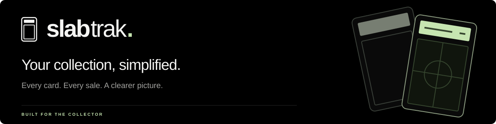
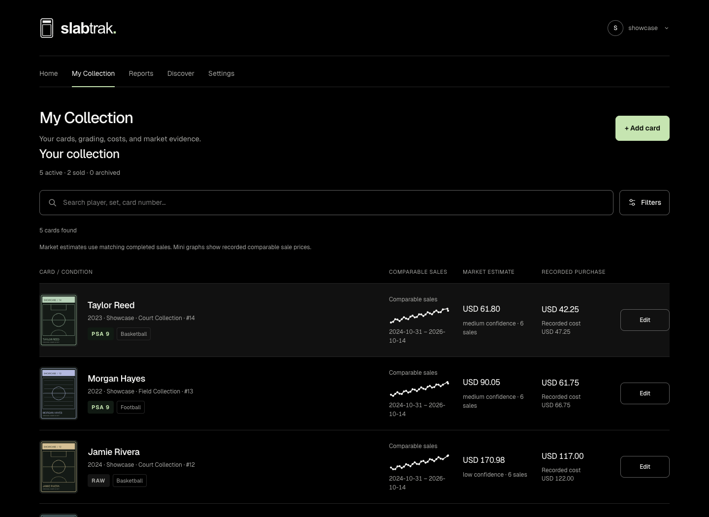

# SlabTrak



[](https://github.com/ZackSilva/slabtrak/actions/workflows/checks.yml)
[](LICENSE)

A private workspace for trading-card collectors. Keep your raw and graded cards, purchase costs, sales and market evidence together in one clean interface.

**[Open the app](https://slabtrak.vercel.app)** · [Get started](docs/getting-started.md) · [FAQ](docs/faq.md) · [Documentation](docs/README.md) · [Roadmap](docs/roadmap.md)

## Your collection, at a glance

- **Know what you own.** Search card rows with image previews, grading details and individual value graphs.
- **Understand your numbers.** Track acquisition costs, sale proceeds after fees and profit in collection-based reports.
- **Research recent sales.** Search completed auctions, inspect listing previews and explore sales directly from a graph.
- **Follow supported estimates.** Confirm exact raw or graded card matches to retrieve comparable auction sales automatically.

Estimates depend on matching evidence. Unknown costs and unsupported values stay unknown, currencies stay separate, and historical charts summarize sales evidence rather than investment returns. [How pricing works →](docs/market-data.md)

[](docs/gallery.md)

*Preview with fictional cards, illustrative prices and original placeholder artwork. [See desktop, reports and mobile views →](docs/gallery.md)*

## Run locally

With Docker running and Python 3 installed, run from the repository folder:

```sh
python3 scripts/setup_local.py
docker compose build
docker compose up -d db
docker compose run --rm --build migrate
docker compose run --rm api python -m slabtrak.cli create-owner --username collector
docker compose up -d api web
```

Open **http://localhost:3000** and sign in with the owner credentials you just created. The password prompt is hidden. [Full setup and maintenance →](docs/getting-started.md)

## Explore the project

| I want to… | Start here |
| --- | --- |
| Preview the app and common questions | [Screenshot gallery](docs/gallery.md) · [FAQ](docs/faq.md) |
| Manage cards, sales and reports | [User guide](docs/user-guide.md) |
| Set up Vercel and Supabase | [Deployment guide](docs/vercel-services.md) |
| Develop, test or contribute | [Development](docs/development.md) · [Contributing](CONTRIBUTING.md) |
| Understand the implementation | [Architecture](docs/architecture.md) · [Design system](docs/design-system.md) |
| Review evidence and changes | [Validation](docs/validation.md) · [Release notes](CHANGELOG.md) |

Built with **Next.js**, **FastAPI** and **PostgreSQL**, with Docker for local use and Vercel/Supabase for hosting.

## Project status

**Early preview.** The hosted app requires an operator-created account. Public sign-up and durable hosted photo storage are still pending. Local and hosted installations keep separate data; installing locally does not copy your online collection. See the [roadmap](docs/roadmap.md) for what comes next.

## License

Source available under [PolyForm Noncommercial 1.0.0](LICENSE). Commercial use outside the license's permissions requires a separate license; [third-party notices](docs/dependencies.md) retain their own terms.
