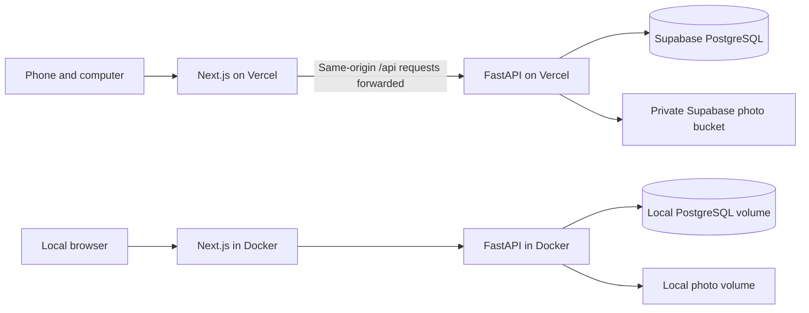

# SlabTrak architecture

Design baseline: October 19, 2026; updated October 20. Status: local private access, five-page navigation, responsive inventory rows, separate private front/back previews, current-sale records, recorded financial summaries, and automatic estimates from private recorded comparables are implemented. Live sales ingestion, hosted deployment, and crash-orphan reconciliation remain planned. See `validation.md` for the evidence boundary.

## Confirmed requirements

- Begin with one collector and approximately 100 cards. Support other collectors later; hobby-shop operations are a stretch goal.
- Keep records persistent and automatically accessible from the user's different devices.
- Host the online application on Vercel and use an approved free cloud database and private photo storage. This supersedes the earlier local-only storage preference for the online deployment.
- Keep a complete independent deployment on owned hardware using Docker Compose, PostgreSQL, and local image files. Core collection management in that deployment must work without internet after dependencies are installed.
- Do not require payment details, paid APIs, subscriptions, or cloud AI for core functionality. Cloud accounts are required only for choosing the hosted deployment.
- Never invent market values, transactions, integrations, test results, or historical portfolio performance.
- Use the supplied master prompt as the product requirements reference. This design records the choices clarified in conversation, rather than treating the document's implementation commands as separate authorization.

Working defaults: USD, dark mode, responsive layouts, and raw plus PSA/BGS/SGC-graded inventory. Currency and supported categories are data, not hardcoded business assumptions. The particular sports and any existing import format are still unknown; they do not block the foundation.

## Deployment

Use one repository with two application directories, `apps/web` and `apps/api`. Both directories now contain the private-access implementation. Each directory will map to its own Vercel project. Use one stable production application URL; configure the frontend's `/api` forwarding to a fixed, trusted backend URL. Never build an arbitrary URL proxy. Verify cookies, CSRF checks, uploads, and error responses through that forwarding path before release.

The backend owns all business rules and authorization. The frontend presents state and makes validated requests; it does not connect directly to the database or receive privileged storage credentials. Supabase provides PostgreSQL and object storage rather than owning application logic.

Docker Compose will run the same frontend/backend code with PostgreSQL and photo volumes. Publish the frontend on localhost by default; keep database and backend services on the internal container network. Use images and dependencies suitable for ARM64 and x86-64, and distinguish ARM testing from actual x86 validation.

Online device syncing means authenticated devices read and update the same database. Save only after a successful server transaction, and refetch relevant views after changes or when returning to the application. Detect concurrent edits with a record revision; report a conflict instead of silently overwriting another device's change. Cross-device visibility does not require a realtime messaging service in the first release.

The local and online installations are separate data stores. Initially, moving between them uses a verified export/import or backup/restore. Automatic synchronization between installations and offline browser edits with later conflict reconciliation are outside the first release. The full local installation provides the independent offline path.

## Technology decisions

| Area | Planned choice | Reason |
| --- | --- | --- |
| Frontend | Next.js, TypeScript, React | Matches the requested stack and Vercel deployment. |
| UI | Tailwind CSS and selected shadcn/ui components | Accessible building blocks and a restrained dark interface. |
| Charts | Small SVG components; Recharts remains optional | Recorded activity uses actual transaction dates. Home and demo-mode row graphs are explicitly fictional USD; market estimates never use simulated history. |
| API | FastAPI, Pydantic, SQLAlchemy, Alembic | Shared validation, persistence, migrations, and OpenAPI documentation across both deployments. |
| Database | PostgreSQL; pooled connections online | One relational model across hosted and local installations. |
| Photos | Private Supabase storage online; local files in Docker | Durable files independent of Vercel's temporary filesystem. |
| Authentication | Application-managed accounts and server sessions | Same login behavior locally and online without an external identity-service dependency. |
| Tests | Pytest, Vitest, Playwright | API/database behavior, calculations, UI logic, and real browser journeys. |
| Background services | None for Milestone 1 | Avoid Redis/Celery until a measured workload needs them. |

Pin compatible stable versions and lock dependencies when implementing. Before installation, review direct/transitive licenses, runtime requirements, security advisories, and any hosted-service dependency. Record package versions and source license links in a dependency inventory. Do not treat an open-source package as proof that its associated hosted service is free. No paid components are selected; dependency-level license verification remains an implementation gate.

Use a small database connection budget in Vercel. Select the Supabase connection mode and SQLAlchemy driver settings together, including prepared-statement compatibility, and test them against the actual hosted database. Run schema migrations as an explicit release operation, never automatically on every request or cold start.

## Identity and authorization

Start with a private owner account; public registration is disabled. Additional collectors will receive separate accounts and separate records. Do not add shop organizations, staff roles, subscription billing, or inventory reservations yet.

Use Argon2id password hashing and cryptographically random opaque sessions. Store only session-token hashes in PostgreSQL. Use HttpOnly cookies, Secure in hosted HTTPS, an appropriate SameSite policy, expiry, logout revocation, and CSRF protection on mutations. Rate-limit login attempts with shared state rather than relying on process-local memory in serverless functions. Never log passwords, tokens, database URLs, or signed photo URLs.

Bootstrap the owner through a controlled setup procedure, with public signup off. Any hosted bootstrap secret is one-time, supplied through environment configuration, and removed afterward. Provide an operator-controlled recovery path without requiring a paid email service. Password reset and recovery must not expose an unauthenticated account takeover route.

Every collection query and mutation must enforce the authenticated owner. Use a dedicated application schema that is not exposed through Supabase's public Data API, separate migration and runtime privileges, and no anonymous database access. Owner consistency must also hold for foreign-key relationships and imported records. Prove isolation with two-account integration tests, including images, backups, imports, search, and aggregate totals.

## Data model

Migration `0002` adds owner-scoped immutable `card_definitions` and separate `owned_copies`. An exact fingerprint of the trimmed identity fields shares matching definitions within an account; correcting one copy selects a new identity without changing its siblings. A composite foreign key prevents references to another owner's definition. Acquisition fields currently live on the physical-copy row; a separate acquisition entity and structured multi-subject links remain planned. The subject field currently stores the entered player/subject text. Unreferenced identity rows can remain after a copy is corrected or removed; private copy notes, grading, and acquisition fields are deleted with the copy.

Inventory writes require the signed-in session, trusted origin, and CSRF token. Updates/deletions require the version the editor loaded; a row lock and SQLAlchemy version counter prevent a stale write. List/detail queries, filters, pagination, and summary counts all enforce the owner. Decimal monetary responses are strings; missing components stay null. Summary tiles contain actual inventory counts, with no portfolio valuation.

The broader entity plan follows; only the entities described above and the account/session foundation are implemented so far.

| Entity | Responsibility and main relationships |
| --- | --- |
| Account | Owner identity, password hash, and preferences. |
| Session | Token hash, account, expiry, and revocation. |
| Card definition | Owner-scoped identity: year, sport/category, manufacturer, set, number, parallel, variation, autograph, memorabilia, and production limit. Multiple physical copies can reference one definition. |
| Card subject | Player or other subject; link multiple subjects to a definition without duplicating the card. |
| Owned copy | A particular physical card: definition, owner, condition, serial number, holding/sold status, grading company, grade, certification, qualifiers, and BGS subgrades. |
| Acquisition | Copy, date, seller, price, shipping, taxes, other costs, and currency. Initial release records one acquisition per owned copy. |
| Sale | Copy, date, gross proceeds, selling fees, shipping expense, other costs, and currency. One sale per copy in the first release. |
| Card image | Copy, front/back designation, storage key, content type, dimensions, size, and checksum. |
| Collection and membership | Owner-defined groups; a copy may belong to more than one collection. |
| Tag and assignment | Owner-scoped labels attached to copies. Notes remain private to their owner. |
| Watchlist and item | Owner's watched card definitions, with optional notes; listing ingestion arrives in Milestone 3. |
| Import record | Owner, format, result summary, source hash, time, and duplicate decisions. |

Migration `0006` also implements private `comparable_sales`: immutable card definition and owner, positive completed-sale price, currency, raw/graded details, sale date, source name/URL, duplicate key, and creation time. Sources are explicitly user-recorded and unverified; source URLs are stored and displayed without fetching them. Shipping, detailed raw condition, and independent source verification remain outside this initial model; estimates explicitly exclude shipping and taxes.

Apply foreign keys, owner consistency, nonnegative cost constraints, and appropriate uniqueness rules. Suspected duplicates require review: two matching owned cards may be distinct physical copies. Do not make catalog text globally unique across all owners. Do not treat a certification number as externally verified without a legitimate lookup result.

Use exact decimal money calculations and ISO currency codes. Unknown values remain null and are displayed as unknown. Sum only compatible currencies; initial UI defaults to USD and separates other currencies rather than inventing exchange rates. Acquisition cost includes all recorded acquisition expenses; realized profit is sale proceeds less selling expenses and acquisition cost. Display an unknown result if required cost data is missing.

Inventory deletion requires a clear confirmation. The current implementation permanently removes the copy and its current financial record, changing summaries and past charts. An immutable transaction ledger and a preview of the exact financial effect of deletion remain planned. Archive unsold records when the user wants to hide them while retaining their acquisition information.

Milestone 1 summaries show owned-card count, recorded acquisition cost, recorded sales, and realized results where complete. Estimated market value and unrealized performance remain unavailable until Milestone 2 provides adequate evidence. No default cost-to-value substitution.

## Image storage and backups

Migration `0003` adds a nullable opaque preview key, image kind, and source to each physical copy. Local preview files use owner UUID/image UUID paths in the named Docker `photos` volume; they are not web-public assets or database blobs. Every image GET checks the authenticated owner. Upload/removal also require origin/CSRF checks and the current card revision. Replacing a preview changes its opaque URL and removes the old file after commit; a failed commit removes the newly written file. Deleting a card removes its previews. Migration `0004` extends this storage to an independent back image while preserving existing front keys and metadata; original-resolution archives remain unimplemented.

Pillow decodes only JPEG, PNG, and WebP still images, bounds input to 4 MB/16 megapixels, normalizes orientation, flattens transparency onto white, and re-encodes a JPEG without EXIF/GPS metadata. Previews have a 1,200-pixel maximum edge and a 1 MB maximum output size. Client image errors fall back to an explicit missing-image state. Reference images on the four example cards are labeled and keep source links; no pictured grade/certification is assigned to those records. The API does not fetch arbitrary image URLs.

Filesystem and SQL changes are coordinated within each request, but a process crash between a completed file write and database commit can still leave an orphan file. Automated orphan reconciliation, independent front/back images, verified complete backup/restore, and private Supabase storage remain release work. Local filesystem storage must not be used as durable Vercel storage.

Validate decoded content, dimensions, size, and supported image types. Reject SVG and executable content for card uploads. Generate opaque storage keys, remove unnecessary metadata, and make display-sized images to keep storage bounded. Present an explicit limit and a useful error when a photo cannot be accepted. Target about 1 MB or less per processed photo as a starting default; 200 such images would be about 200 MB, an estimate rather than a measured collection size.

The backend verifies ownership before accepting uploads or returning images. Keep hosted buckets private; provide short-lived authorized access when needed. The local storage path must stay inside the configured photo volume. Never use user-supplied filenames as trusted paths. Reconcile interrupted uploads so failures do not create invisible orphan files or successful-looking records without photos.

Offer a full user backup containing inventory, collections, tags, notes, acquisitions, sales, and image files with a versioned manifest and checksums. CSV is an inventory interchange format, not a full backup. JSON exports must document whether photos are included; full backups must actually contain them. Exclude session tokens, password hashes, and service credentials from user backups.

Restore must validate the format and ownership, show conflicts, preserve the existing collection until validation succeeds, and roll back incomplete changes. Test a complete restore into an empty database and verify photos and financial totals. Operational recovery also needs database backup plus storage backup; a database dump alone does not restore image objects.

## Cost and availability boundaries

Supabase currently lists a 500 MB database, 1 GB file storage, and usage/transfer quotas on Free. It lists pausing after one week of inactivity, no included automatic database backups, and no uptime SLA. Vercel Hobby also has usage limits and noncommercial-personal-use restrictions. Verify these terms at setup; never activate a paid plan, trial, add-on, or automatic upgrade to bypass a limit.

Durable records mean database commits survive page reloads and application deployments. They do not mean guaranteed provider availability or protection against accidental deletion. Maintain portable backups, report outages clearly, and keep the local deployment usable. Growth to a commercial hobby-shop product requires a new hosting and cost review; the personal free deployment is not a promise of free commercial hosting.

## Deployment preparation

Before publishing, identify the exact Vercel account/team, frontend and backend projects, stable URLs, intended audience, Supabase project/region, private bucket, and source version. The user completes account sign-in and enters secrets through local environment files or provider settings, never in chat or Git.

Keep local development and previews away from the real collection database. If only one free database is available, use isolated development data locally rather than pointing unreviewed previews at production. Verify that deployment protection does not accidentally block frontend-to-backend requests. Run hosted migrations deliberately, then verify login, add/edit/search, photo access, restart persistence, cross-device access, and backup/restore on the deployed version.

## References

Provider documentation reviewed October 19, 2026; not evidence that an account or deployment has been configured.

- [Vercel monorepos](https://vercel.com/docs/monorepos)
- [FastAPI on Vercel](https://vercel.com/docs/frameworks/backend/fastapi)
- [Vercel function filesystem](https://vercel.com/docs/functions/runtimes#file-system-support)
- [Vercel Hobby plan](https://vercel.com/docs/plans/hobby)
- [Supabase pricing and limits](https://supabase.com/pricing)
- [Supabase PostgreSQL connections](https://supabase.com/docs/guides/database/connecting-to-postgres)
- [Supabase schemas and API exposure](https://supabase.com/docs/guides/api/using-custom-schemas)
- [Supabase private storage buckets](https://supabase.com/docs/guides/storage/buckets/fundamentals)

## Independent front/back previews

Migration `0004` adds nullable back-photo keys and separate kind/source metadata to each physical copy. Existing `photo_*` columns, keys, reference metadata, and default `/photo` URLs remain the front side. `GET`, `PUT`, and `DELETE /api/cards/{id}/photo` accept `side=front|back`, defaulting to front. Back URLs include `side=back`; every request remains owner scoped and non-cacheable. Both sides share the copy revision, so a stale photo mutation cannot overwrite a newer change on either side.

The existing bounded image processing and private local storage are reused. Replacing or removing one side preserves the other. Deleting a physical copy removes both photo files after the database commits; failed commits retain old files and remove a new uncommitted upload. Files orphaned by an abrupt process crash still need operator reconciliation; this update does not claim to implement it. Private hosted storage remains a later provider integration.

## Separate card viewing and editing

Collection row bodies, titles, and thumbnails open a read-only `CardDetail` dialog populated from the authenticated card record. Native title buttons provide keyboard access; Edit and inline disclosures retain independent actions. The detail view renders labeled text, photos, and recorded costs without form fields or save/archive/delete/upload controls. It makes no mutation request. Existing owner scoping and optimistic revision checks continue to protect editor writes.

The detail component retains its selected photo side while its native dialog closes temporarily for editing or image enlargement; only one dialog is open at a time. Returning restores focus to the originating detail control. Successful saves, conflict reloads, and photo updates refresh the retained detail record; canceling leaves the saved record intact. Closing details restores the original row control or the collection heading if that row was removed. No API, database, dependency, or hosting changes are needed for this view.

## Current sale record

Migration `0005` adds `sold` (false by default), nullable decimal `sale_price` and `sale_fees`, and optional `sold_on` to each physical copy. Sold cards require explicit nonnegative price and fees, including zero. Fees may exceed price, producing negative proceeds. Database and input constraints prohibit simultaneous sold/archive states and sale fields on an unsold record. Existing copies migrate as unsold without changing their other fields or revisions.

Server-side Decimal arithmetic derives `sale_net`, `net_profit` against purchase price, and `profit_after_costs` against all four recorded acquisition amounts. Missing purchase price prevents purchase-based profit; any missing acquisition amount prevents the complete-cost result. Computed fields are output-only. The editor previews the same formulas with bounded integer cents; persisted API output remains authoritative. Every amount uses the copy's single recorded currency, without exchange-rate conversion.

Sales use the existing owner-scoped, CSRF-protected, revision-checked card update. Legacy metadata requests omitting all sale fields retain the current sale instead of silently clearing it. Explicitly returning a copy to collection clears the current sale fields; this is an editable current sale record, not an event ledger. Photo updates retain sale/grade metadata. Sold cards are omitted from active lists/counts and the active-card demo overview, while `status=sold` and `status=all` retain access to the records. Sold rows show recorded proceeds/profit rather than simulated valuations.

## Recorded financial projection

Authenticated `GET /api/finances?range=all|1y|6m|3m|1m|1w` selects every physical copy belonging to the current owner. It is read-only, uses existing models without a migration, and ignores inventory list filters and pagination. Currency groups are independent; the API returns Decimal strings, not binary floating-point totals. Each metric includes amount, known count, complete count, and eligible count. No eligible records produce zero; eligible records with no known amounts produce null. Known acquisition components form a disclosed subtotal. Complete-cost profit includes only sales with all four acquisition amounts present, while the separately labeled purchase-price comparison requires only purchase price. Zero is an explicit known amount.

Spending uses acquisition date and sales/results use sale date, retaining the original acquisition basis even when purchased outside the sale period. All-time totals include undated transactions; dated ranges and sparse daily chart series exclude them and disclose counts. Future-dated activity is excluded until its date and counted separately. All periods end on the current UTC date, inclusively; a week includes today and six prior days, and month/year subtraction clamps to the calendar month end. Current owned cost includes every unsold copy, including archived and undated/future-dated acquisitions, independently of the selected transaction period.

The frontend requests this projection after saves/deletions and window focus, cancels obsolete requests, separates currencies, and hides stale values during loading or failure. Chart bars represent daily activity on actual dates; calendar gaps are retained and no market or ownership history is fabricated. The existing demo valuation chart stays separate. Corrections, sale reversals, and deletion change the saved records and therefore past activity; this projection does not provide an immutable accounting ledger.

## Workspace pages and comparable-based estimates

The Next.js `(workspace)` route-group layout retains one authenticated client shell and session context across `/`, `/collection`, `/reports`, `/discover`, and `/settings`. Navigation uses real links and active-page semantics. Page content and its data hooks mount only after successful session validation. Direct links show the same private sign-in screen when anonymous; server APIs independently enforce authorization. The `/design` reference remains outside the private workspace. Home opens with the expanded, explicitly fictional value chart, followed by collection counts and recorded-market coverage; Reports owns all detailed financial controls. Collection rows default to labeled Demo mode with mini graphs, and a separate Recorded market data mode retains genuine estimates without fabricating history. These presentation choices stay in component memory and never write card amounts. Sold rows always use recorded results. Settings currently describes the account, installation, and actual data-source status; Discover remains a roadmap placeholder without fake search or AI results.

Read-only `GET /api/estimates` calculates estimates for all the owner's unsold cards, including archived copies, with Decimal median and observed min/max from at least three completed sales within the inclusive 180-day UTC window. Exact immutable identity and currency must match. Raw cards use only raw comparables and low confidence because individual condition is not verified. Graded cards require matching normalized grader and grade; numeric grade 9 and 9.0 match. Three or four graded sales have low confidence; five or more have medium confidence, with sources still explicitly unverified. There is no arbitrary grade conversion, exchange rate, or external fetch. Missing estimates remain null. Home sums only supported estimates within one selected currency using integer cents and displays the covered-card count; incomplete coverage is not described as total collection value.

`GET /api/cards/{id}/comparables` shows the owner's evidence for that exact definition, including other grades, currencies, and older sales as context. Authenticated, trusted-origin, CSRF-protected POST/DELETE requests add/remove evidence on a separate `/collection/{id}/market` page. Source URLs allow only HTTP(S) without credentials and never trigger a request from the server. An owner-scoped unique key rejects a normalized repeated URL or an identical source/date/price/identity/grade tuple without a URL; alternate URLs and independent transaction verification remain limitations. POST requires the expected definition UUID and rejects an identity changed in another session before writing. Evidence is shared between the owner's identical card definitions, not global across collectors. It survives a copy's correction or deletion on the prior definition; deletion of an account cascades its private evidence. Removing a comparable explains that estimates for all matching copies will change. Adding evidence never mutates an owned card's grade, purchase, sale, or revision.

The automatic calculation foundation uses manual evidence entry. A provider must demonstrate working access, usage rights, completed-sale provenance, and raw/graded coverage before enabling automated ingestion. See `market-data.md` for checked official-source boundaries and remaining research candidates. Market-wide analytics, a reliable live feed, raw-condition matching, outlier review, and defensible cross-grade inference remain open.
