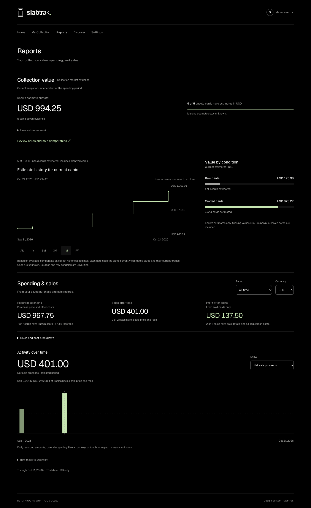
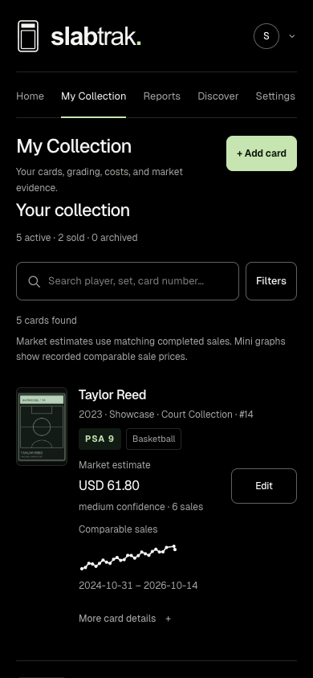
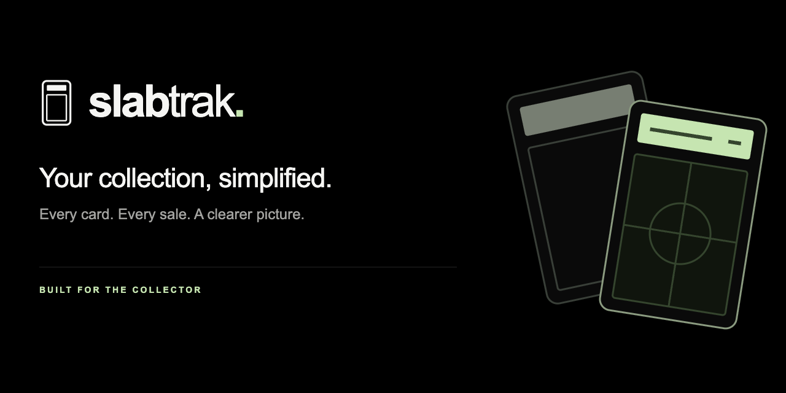

# A look inside SlabTrak

[Project](../README.md) · [FAQ](faq.md) · [User guide](user-guide.md)

These October 21, 2026 screenshots show the actual local web app with a separate sample collection: seven fictional cards, illustrative purchase costs and sale observations, and original placeholder artwork. They contain no private collection records or photos and no live provider results. They illustrate the interface, not real card prices or investment performance.

## Collection

Card rows bring photos, grades, purchase costs, estimated values and small history graphs together. Select a row for its read-only detail view, then choose **Edit** to make changes.

## Reports

Reports combine collection estimates with recorded acquisition costs, proceeds after fees and profit. Current estimates and recorded finances use separate date scopes; incomplete or unsupported figures remain unknown. [How these numbers work](user-guide.md#reports-and-recorded-finances).

## On your phone

The same collection works in a mobile browser, with navigation and card rows adapted to a narrow screen. This is a 390-pixel-wide headless Chrome preview; physical iPhone and Safari behavior have not yet been verified.

## Repository social preview

[Download the 1280 × 640 PNG](assets/social-preview.png) or edit its [SVG source](assets/social-preview.svg). This artwork contains branding only.

A repository administrator can upload the PNG in **GitHub → repository Settings → General → Social preview → Edit → Upload an image**. The image is under 1 MB and follows [GitHub's recommended dimensions](https://docs.github.com/en/repositories/managing-your-repositorys-settings-and-features/customizing-your-repository/customizing-your-repositorys-social-media-preview). Adding the file to Git alone does not configure that setting.
